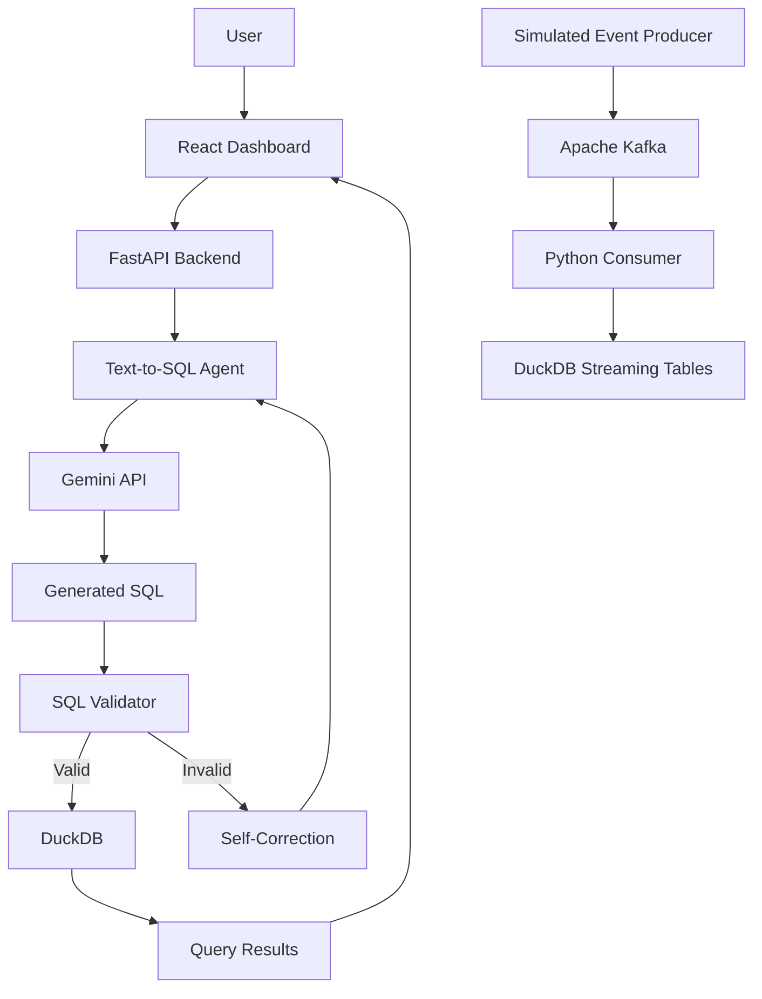

# FoodSQL-Agent
### A Streaming-Enabled, Self-Correcting Text-to-SQL System for Food-Delivery Analytics

FoodSQL-Agent is an AI-powered analytics prototype that converts natural-language questions into SQL queries and retrieves insights from a food-delivery database. It combines schema-aware Text-to-SQL generation, read-only SQL validation, bounded self-correction, DuckDB analytics, and Kafka-based simulated streaming.

---

## 1. Project Overview

FoodSQL-Agent makes database analytics accessible through natural language. Users can ask analytical questions without manually writing SQL queries.

The system generates SQL using database schema information, validates the generated query, executes it against DuckDB, and returns the results.

If a generated query fails validation or execution, the agent can attempt to correct it through a bounded self-correction mechanism.

Simulated food-order events are also transmitted through Apache Kafka and processed by a Python consumer before being stored in DuckDB.

## 2. Key Features

- Natural Language to SQL conversion
- Schema-aware SQL generation
- Read-only SQL validation
- Bounded self-correction (maximum 3 repair attempts)
- DuckDB analytical query execution
- Apache Kafka-based simulated event streaming
- FastAPI backend
- React-based dashboard
- Text-to-SQL performance evaluation
- Streaming performance evaluation

## 3. System Architecture



## 4. Technology Stack

| Component | Technology |
|---|---|
| Programming Language | Python |
| AI Model | Gemini API |
| Text-to-SQL | Prompt Engineering |
| SQL Validation | SQLGlot, DuckDB EXPLAIN |
| Analytical Database | DuckDB |
| Streaming Platform | Apache Kafka |
| Backend | FastAPI |
| Frontend | React, Vite |
| Data Processing | Pandas |
| Evaluation | Python, JSON, Matplotlib |
| Development Environment | WSL2 Ubuntu, VS Code |

## 5. Project Structure

```text
foodsql-agent/
│
├── datasets/
│   └── text2sql/
│       ├── schema.txt
│       ├── train.jsonl
│       ├── test.jsonl
│       └── robustness_test.jsonl
│
├── db/
│
├── frontend/
│   ├── src/
│   └── package.json
│
├── results/
│   ├── final_evaluation_report.md
│   ├── summary_table.md
│   ├── summary_table.csv
│   ├── accuracy_chart.png
│   ├── gemini_full_prompt_v5.json
│   └── gemini_prompt_v8_robustness20.json
│
├── src/
│   ├── agent/
│   │   ├── agent.py
│   │   ├── models.py
│   │   ├── prompts.py
│   │   ├── schema.py
│   │   └── validator.py
│   │
│   ├── api/
│   │   └── main.py
│   │
│   ├── streaming/
│   │   ├── producer.py
│   │   ├── consumer.py
│   │   └── analytics.py
│   │
│   ├── evaluation/
│   │   ├── run_eval.py
│   │   ├── metrics.py
│   │   ├── make_report.py
│   │   └── make_final_summary.py
│   │
│   ├── benchmark/
│   ├── data_generation/
│   ├── data_pipeline/
│   ├── finetune/
│   └── utils/
│
├── notebooks/
├── kafka_2.13-4.4.0/
├── requirements.txt
├── compose.yaml
└── README.md
```

## 6. Installation and Setup

### Prerequisites

- Windows 11 or Linux
- WSL2 with Ubuntu 24.04 (Windows development setup)
- Python 3.11
- Miniconda or Anaconda
- Node.js and npm
- Apache Kafka 4.x
- Gemini API key

### Step 1: Clone Repository

```bash
git clone https://github.com/tahirzamansoomro/foodsql-agent.git
cd foodsql-agent
```

### Step 2: Create and Activate Environment

```bash
conda create -n foodsql python=3.11 -y
conda activate foodsql
```

### Step 3: Install Python Dependencies

```bash
pip install -r requirements.txt
```

### Step 4: Configure Environment Variables

Create a `.env` file in the project root and configure the required Gemini API credentials and application settings.

**Important:** Never upload `.env` or API keys to GitHub.

### Step 5: Install Frontend Dependencies

```bash
cd frontend
npm install
```

## 7. Running the Project

Run the following components in separate terminal windows.

### Terminal 1 — Apache Kafka

```bash
cd /mnt/d/Github/foodsql-agent/kafka_2.13-4.4.0
bin/kafka-server-start.sh config/server.properties
```

### Terminal 2 — Create Kafka Topic

```bash
cd /mnt/d/Github/foodsql-agent/kafka_2.13-4.4.0

bin/kafka-topics.sh --create --if-not-exists \
--topic food-orders \
--bootstrap-server localhost:9092 \
--partitions 1 \
--replication-factor 1
```

### Terminal 3 — Kafka Consumer

```bash
cd /mnt/d/Github/foodsql-agent
conda activate foodsql

python -m src.streaming.consumer
```

### Terminal 4 — FastAPI Backend

```bash
cd /mnt/d/Github/foodsql-agent
conda activate foodsql

uvicorn src.api.main:app --host 0.0.0.0 --port 8000 --reload
```

### Terminal 5 — React Frontend

```bash
cd /mnt/d/Github/foodsql-agent/frontend

npm run dev
```

### Terminal 6 — Simulated Event Producer

Start the producer after the Kafka consumer is ready.

```bash
cd /mnt/d/Github/foodsql-agent
conda activate foodsql

python -m src.streaming.producer
```

## 8. Application URLs

| Service | URL |
|---|---|
| React Dashboard | http://localhost:5173 |
| FastAPI Backend | http://localhost:8000 |
| API Documentation | http://localhost:8000/docs |

## 9. Text-to-SQL Evaluation

Two separate Text-to-SQL experiments were conducted.

### Main Benchmark — Prompt V5

| Metric | Result |
|---|---:|
| Questions | 81 |
| Execution Accuracy | 100% (81/81) |
| Valid SQL Rate | 100% |
| Average Latency | 4.62 seconds |
| Average Attempts | 1.01 |
| Total API Cost | $0.0725 |

Dataset split:

- In-distribution: 53/53 correct
- Held-out: 28/28 correct

### Independent Robustness Evaluation — Prompt V8

| Metric | Result |
|---|---:|
| Questions | 20 |
| Execution Accuracy | 85% (17/20) |
| Valid SQL Rate | 100% |
| Average Latency | 1.66 seconds |
| Average Attempts | 1.00 |
| Total API Cost | $0.0211 |

Difficulty-wise results:

- Easy: 100% (2/2)
- Medium: 93.3% (14/15)
- Hard: 33.3% (1/3)

The robustness evaluation identified challenges involving NULL category preservation, custom sorting rules, and category comparison ordering.

**Note:** These experiments use different question sets and prompt versions. Their accuracy values must not be combined into a single score.

## 10. Kafka Streaming Evaluation

A controlled experiment was conducted using 100 simulated order events.

| Metric | Result |
|---|---:|
| Events Sent | 100 |
| Events Stored in DuckDB | 100 |
| Events Received | 100 |
| Valid Latency Samples | 99 |
| Negative Latency Samples | 1 |
| Average Valid Latency | 11.50 ms |
| Minimum Valid Latency | 2.68 ms |
| Maximum Valid Latency | 128.06 ms |
| Observed Throughput | 9.48 events/second |

One negative latency sample was excluded from the average because of a timestamp inconsistency.

The measured throughput represents this controlled experiment, not the maximum capacity of the system.

## 11. SQL Safety and Validation

The SQL validation component applies application-level checks before query execution.

The validation process includes:

1. Checking SQL syntax.
2. Rejecting multiple SQL statements.
3. Allowing read-only query structures.
4. Blocking potentially unsafe SQL operations.
5. Blocking external file-reading and potentially dangerous functions.
6. Using DuckDB EXPLAIN to check query planning.
7. Supporting bounded self-correction when validation or execution fails.

These safeguards improve query safety but do not provide complete database security isolation.

## 12. Limitations

- The Text-to-SQL evaluation uses limited domain-specific datasets.
- The main benchmark and independent robustness test have different question sets and prompt versions.
- Streaming events are simulated rather than obtained from a real food-delivery platform.
- One negative latency sample indicates a timestamp consistency issue.
- Throughput measurements are limited to the tested workload and environment.
- Application-level SQL validation cannot guarantee semantic correctness or complete security isolation.
- Gemini API latency, availability, and cost may change.

## 13. Future Improvements

- Expand the independent robustness dataset.
- Improve semantic generalization for complex analytical questions.
- Improve timestamp synchronization and latency measurement.
- Evaluate performance under larger streaming workloads.
- Explore additional language models and model configurations.
- Improve database isolation and deployment security.
- Extend dashboard analytics and monitoring capabilities.

## 14. Conclusion

FoodSQL-Agent demonstrates an integrated analytics prototype combining natural-language-to-SQL generation, SQL validation, bounded self-correction, DuckDB analytics, and Kafka-based simulated event processing.

The main benchmark achieved 100% execution accuracy across 81 questions, while the independent robustness experiment achieved 85% across 20 questions. The controlled streaming experiment successfully stored all 100 generated events.

The project demonstrates the feasibility of combining AI-driven database querying with streaming-enabled food-delivery analytics while identifying areas for further improvement.

---

## Author

**Tahir Zaman Soomro**

BS Data Science  
Quaid-e-Awam University of Engineering, Science & Technology (QUEST), Nawabshah, Pakistan.

- GitHub: https://github.com/tahirzamansoomro
- LinkedIn: https://www.linkedin.com/in/tahirzamansoomro
- Portfolio: https://tahir-zaman-web-portfolio.vercel.app

## Supervisor

**Mr. Waqas Ahmed Khilji**  
Lecturer in Data Science  
Quaid-e-Awam University of Engineering, Science & Technology (QUEST)

---

*Academic Final Year Project — FoodSQL-Agent*
